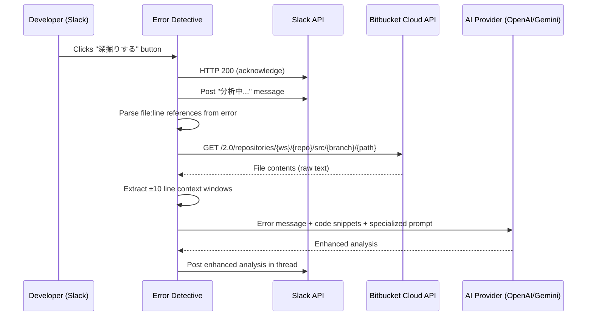

# Design Document: Bitbucket Dig Deeper

## Overview

This feature adds a "深掘りする" (Dig Deeper) button to the Error Detective Slack bot that fetches source code from Bitbucket Cloud API and performs a follow-up AI analysis with code context. This replaces the broken local `REPO_ROOTS` file-reading approach that fails on render.io deployments.

The implementation introduces a new `bitbucket.go` module for Bitbucket Cloud API communication, modifies the Slack interaction handler to support the new button action, and adds a specialized AI re-analysis flow that includes fetched code snippets.

## Architecture



### Design Decisions

1. **New file `bitbucket.go`** — Keeps Bitbucket API logic isolated from existing code. Follows the project's ongoing refactoring pattern (ai.go, backlog.go, etc.).

2. **Reuse ticket_cache for dig-deeper context** — The existing `ticketContext` cache already stores error text and thread info. We extend it with a new cache (or reuse the same pattern) to pass context to the async dig-deeper handler.

3. **Bitbucket replaces REPO_ROOTS entirely** — The existing `gatherContext()` in context.go and `REPO_ROOTS` handling are removed. Bitbucket is the sole code context source. If not configured, code context is simply skipped.

4. **Async processing** — Same pattern as the existing Backlog ticket creation: acknowledge Slack immediately, process in a goroutine.

## Components and Interfaces

### New File: `bitbucket.go`

```go
package main

// bitbucketConfigured returns true when Bitbucket credentials are available
// (BITBUCKET_APP_PASSWORD is set, or unauthenticated access is acceptable).
func bitbucketConfigured() bool

// FileRef represents a parsed file path and line number from an error message.
type FileRef struct {
    Workspace string // Bitbucket workspace (e.g., "mobilusall")
    RepoSlug  string // Repository slug (e.g., "mbv-api" or "mbv-agi")
    Path      string // repository-relative path
    Line      int    // 1-based line number
}

// parseFileRefs extracts up to maxRefs file:line references from an error
// message. Parses workspace and repo slug from the path itself
// (e.g., /go/src/bitbucket.org/mobilusall/mbv-api/path/file.go:123).
// Normalizes paths to be repository-relative and deduplicates.
func parseFileRefs(msg string, maxRefs int) []FileRef

// normalizePath parses a full file path containing bitbucket.org/{workspace}/{repo}/
// and returns the workspace, repo slug, and repository-relative path.
func normalizePath(path string) (workspace, repoSlug, relativePath string)

// fetchBitbucketContext fetches code snippets from Bitbucket Cloud API for
// the given file references. Returns formatted context string capped at
// maxTotalChars. Skips files that return errors.
func fetchBitbucketContext(refs []FileRef, maxTotalChars int) string

// fetchFileFromBitbucket fetches raw file content from Bitbucket Cloud API
// for the given workspace, repo slug, and path.
// Returns the file content as a string, or an error if the request fails.
func fetchFileFromBitbucket(workspace, repoSlug, path string) (string, error)

// extractLines extracts a window of context lines around the target line.
// Returns lines [targetLine-above, targetLine+below] clamped to file bounds.
func extractLines(content string, targetLine, above, below int) string
```

### Modified File: `slack.go`

- `postToSlackWithCreateButton` — Extended to include the "深掘りする" button in the actions block when `bitbucketConfigured()` returns true.

### Modified File: `main.go`

- `/slack/interactions` handler — Extended to handle `action_id == "dig_deeper_bitbucket"` in addition to the existing `"create_backlog_ticket"`.

### New Function: `explainErrorWithContext` in `ai.go`

```go
// explainErrorWithContext generates an AI explanation using both the error
// message and pre-fetched code context, with a specialized deep-analysis prompt.
func explainErrorWithContext(msg string, codeContext string) string
```

## Data Models

### FileRef

| Field     | Type   | Description                                    |
| --------- | ------ | ---------------------------------------------- |
| Workspace | string | Bitbucket workspace (e.g., "mobilusall")       |
| RepoSlug  | string | Repository slug (e.g., "mbv-api" or "mbv-agi") |
| Path      | string | Repository-relative file path                  |
| Line      | int    | 1-based line number from stack trace           |

### Environment Variables (New)

| Variable               | Required | Default  | Description                             |
| ---------------------- | -------- | -------- | --------------------------------------- |
| BITBUCKET_USERNAME     | No       | —        | Username for Basic Auth                 |
| BITBUCKET_APP_PASSWORD | No       | —        | App password or repository access token |
| BITBUCKET_BRANCH       | No       | "master" | Branch or commit ref for file fetching  |

Note: Workspace and repo slug are parsed dynamically from file paths in error messages (e.g., `bitbucket.org/mobilusall/mbv-api/...`), so no env vars are needed for those.

### Bitbucket API Request

```
GET https://api.bitbucket.org/2.0/repositories/{workspace}/{repo_slug}/src/{branch}/{path}
Authorization: Basic base64({username}:{app_password})
```

Response: Raw file content (text/plain) when no format parameter is specified.

### Constants

| Name              | Value | Description                                    |
| ----------------- | ----- | ---------------------------------------------- |
| maxFileRefs       | 5     | Maximum file references to extract per message |
| contextLinesAbove | 10    | Lines of context above the referenced line     |
| contextLinesBelow | 10    | Lines of context below the referenced line     |
| maxContextChars   | 8000  | Maximum total characters for code context      |

## Correctness Properties

_A property is a characteristic or behavior that should hold true across all valid executions of a system — essentially, a formal statement about what the system should do. Properties serve as the bridge between human-readable specifications and machine-verifiable correctness guarantees._

### Property 1: Dig Deeper button presence when configured

_For any_ non-empty explanation string and error text, when Bitbucket is configured, the generated Slack message payload SHALL contain a button element with action_id "dig_deeper_bitbucket" in the actions block.

**Validates: Requirements 1.1**

### Property 2: Dig Deeper button omission when not configured

_For any_ non-empty explanation string and error text, when Bitbucket is NOT configured (BITBUCKET_WORKSPACE or BITBUCKET_REPO_SLUG is empty), the generated Slack message payload SHALL NOT contain a button with action_id "dig_deeper_bitbucket".

**Validates: Requirements 1.4**

### Property 3: File reference parsing with workspace and repo extraction

_For any_ error message containing file paths with the pattern `bitbucket.org/{workspace}/{repo}/...file.go:{line}`, the parser SHALL correctly extract the workspace, repo slug, repository-relative path, and line number for each reference.

**Validates: Requirements 2.1, 2.2, 2.4**

### Property 4: Maximum file references invariant

_For any_ error message regardless of how many file:line references it contains, the parser SHALL return at most 5 file references.

**Validates: Requirements 2.3**

### Property 5: Context window extraction

_For any_ file content string and valid target line number, the extracted context window SHALL contain exactly the lines from `max(1, targetLine-10)` to `min(totalLines, targetLine+10)`, inclusive.

**Validates: Requirements 3.5**

### Property 6: Total context size limit

_For any_ set of file references and their corresponding file contents, the combined code context string returned by `fetchBitbucketContext` SHALL not exceed 8000 characters.

**Validates: Requirements 3.6**

### Property 7: Bitbucket configuration check

_For any_ value of `BITBUCKET_APP_PASSWORD`, `bitbucketConfigured()` SHALL return true if the value is non-empty after trimming whitespace, OR if the application is configured to allow unauthenticated access.

**Validates: Requirements 6.3**

## Error Handling

| Scenario                                     | Behavior                                                       |
| -------------------------------------------- | -------------------------------------------------------------- |
| Bitbucket API returns 404 for a file         | Skip that file, continue with remaining references             |
| Bitbucket API returns 401/403                | Skip that file, log authentication error                       |
| Bitbucket API timeout or network error       | Skip that file, continue with remaining references             |
| All file fetches fail                        | Post error message: "コード取得に失敗しました" in thread       |
| No file:line references found in error       | Post message: "コード参照が見つかりませんでした" in thread     |
| AI provider returns error during re-analysis | Post error message in thread indicating analysis failed        |
| Ticket context cache miss (expired/missing)  | Fetch original error from Slack API via `getParentMessageText` |
| BITBUCKET_APP_PASSWORD not set               | Attempt unauthenticated access (works for public repos only)   |
| Bitbucket not configured                     | Skip code context gathering entirely (no fallback)             |

## Testing Strategy

### Property-Based Tests

Using Go's `testing/quick` package (standard library) for property-based testing:

- **Minimum 100 iterations** per property test
- Each test tagged with: `Feature: bitbucket-dig-deeper, Property {N}: {description}`
- Focus on pure functions: `parseFileRefs`, `normalizePath`, `extractLines`, `bitbucketConfigured`, payload building

### Unit Tests (Example-Based)

- Button action_id is exactly "dig_deeper_bitbucket" (Req 1.2)
- Button text is plain_text "深掘りする" (Req 1.3)
- Default branch is "master" when BITBUCKET_BRANCH not set (Req 3.3)
- Authentication header format with Basic Auth (Req 3.2)
- Skipping failed files while returning successful ones (Req 3.4)
- "分析中..." interim message posted before analysis (Req 4.5)
- HTTP 200 returned immediately on interaction (Req 5.1)
- Fallback to Slack API when cache misses (Req 5.3)
- Error message posted when all fetches fail (Req 5.4)
- Old gatherContext and REPO_ROOTS fully removed (Req 7.2)
- Code context skipped when Bitbucket not configured (Req 7.3)

### Integration Tests

- End-to-end flow with mocked Bitbucket API and mocked AI provider
- Verify correct Bitbucket API URL construction (Req 3.1)
- Verify AI receives both error message and code context (Req 4.1)
- Verify threaded reply posted to correct channel/thread (Req 4.3)

### Test Configuration

```go
// Property-based tests use testing/quick with 100+ iterations
import "testing/quick"

func TestParseFileRefsProperty(t *testing.T) {
    // Feature: bitbucket-dig-deeper, Property 3: File reference parsing and normalization
    config := &quick.Config{MaxCount: 100}
    // ...
}
```
