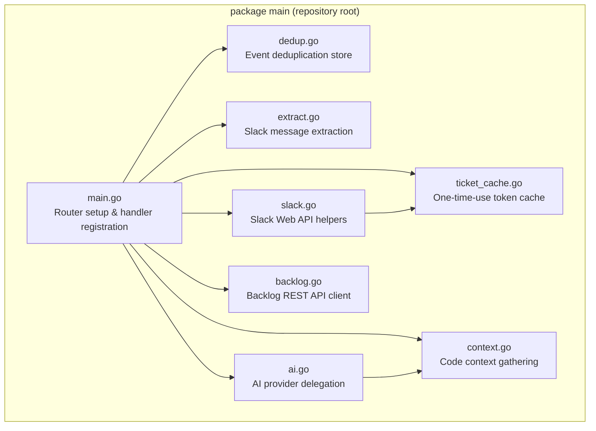

# Design Document: Monolith Refactor

## Overview

This design describes how to decompose the single-file Error Detective Slack bot (`main.go`, ~600 lines) into multiple focused files within `package main`. The refactoring is purely structural — no behavioral changes, no new dependencies, no new packages. Each file encapsulates a single logical concern, making the codebase easier to navigate, review, and extend.

The decomposition follows the natural boundaries already present in the monolith: deduplication, ticket caching, Backlog API integration, Slack API interactions, AI provider delegation, message extraction, and code context gathering.

## Architecture

The application remains a single Go binary built from multiple `.go` files in `package main` at the repository root. All files share the same package namespace, so functions and package-level variables are accessible across files without export.



**Key architectural decisions:**

1. **No interfaces or dependency injection** — The current code uses package-level state and direct function calls. The refactoring preserves this style to minimize diff and risk.
2. **Handler logic stays in main.go** — The HTTP handler closures reference multiple concerns (dedup, extract, AI, Slack, Backlog). Keeping them in `main.go` provides a single place to understand request flow.
3. **`any` replaces `interface{}`** — All occurrences of `interface{}` are updated to `any` (Go 1.18+ type alias) for idiomatic style.

## Components and Interfaces

### File Decomposition

| File              | Responsibility                                          | Key Symbols                                                                                                                                        |
| ----------------- | ------------------------------------------------------- | -------------------------------------------------------------------------------------------------------------------------------------------------- |
| `main.go`         | Entry point, Gin router, handler registration           | `main()`                                                                                                                                           |
| `dedup.go`        | In-memory event deduplication with 15-min TTL           | `processed`, `hasProcessed()`, `markProcessed()`                                                                                                   |
| `ticket_cache.go` | One-time-use token cache for Backlog button clicks      | `ticketContext`, `cacheItem`, `ticketCache`, `getBacklogTokenTTL()`, `genToken()`, `putTicketContext()`, `takeTicketContext()`                     |
| `backlog.go`      | Backlog REST API v2 integration                         | `backlogConfigured()`, `generateIssueSummary()`, `buildBacklogIssue()`, `backlogProjectIDCache`, `resolveProjectID()`, `createBacklogIssue()`      |
| `slack.go`        | Slack Web API helpers (posting, permalinks, signatures) | `verifySlackSignature()`, `postToSlack()`, `postToSlackWithCreateButton()`, `postToSlackSimple()`, `getSlackPermalink()`, `getParentMessageText()` |
| `ai.go`           | AI provider selection and prompt construction           | `explainError()`                                                                                                                                   |
| `extract.go`      | Slack event payload → plain text extraction             | `extractFullSlackMessage()`                                                                                                                        |
| `context.go`      | Stack trace file:line → code snippet resolution         | `gatherContext()`                                                                                                                                  |

### Import Distribution

Each file declares only the imports it needs. The `main.go` file will have minimal imports (primarily `gin`, `godotenv`, `log`, `net/http`, standard I/O for the handler bodies).

### Handler Registration Pattern

`main.go` contains the full handler closures inline (not extracted to named functions) because:

- Handlers orchestrate across multiple concerns
- Keeping them inline in `main.go` gives a single-file overview of all request routing
- The handlers are short enough (~50 lines each) to remain readable

## Data Models

No new data models are introduced. Existing types remain unchanged:

```go
// ticket_cache.go
type ticketContext struct {
    Channel     string
    ThreadTS    string
    ErrorText   string
    Explanation string
}

type cacheItem struct {
    Ctx    ticketContext
    Expire time.Time
}
```

Package-level variables (dedup map, ticket cache map, backlog project ID cache) remain as unexported package-level `var` declarations in their respective files.

## Correctness Properties

_A property is a characteristic or behavior that should hold true across all valid executions of a system — essentially, a formal statement about what the system should do. Properties serve as the bridge between human-readable specifications and machine-verifiable correctness guarantees._

### Property 1: Dedup store idempotence and isolation

_For any_ event ID string, marking it as processed and then immediately checking `hasProcessed` should return `true`. Furthermore, _for any_ two distinct event ID strings, marking one as processed should not cause `hasProcessed` to return `true` for the other.

**Validates: Requirements 3.3**

### Property 2: Message extraction completeness

_For any_ Slack event map containing a non-empty top-level `text` field, the output of `extractFullSlackMessage` should contain that text. Similarly, _for any_ event map with attachment `pretext`, `title`, or `text` fields, those non-empty values should appear in the extracted output.

**Validates: Requirements 3.4**

### Property 3: Ticket cache one-time-use semantics

_For any_ valid `ticketContext` and positive TTL duration, calling `putTicketContext` produces a token, and calling `takeTicketContext` with that token should return the original context exactly once. A second call to `takeTicketContext` with the same token should return `false`.

**Validates: Requirements 3.8**

## Error Handling

No changes to error handling behavior. The refactoring preserves:

- Silent `log.Println` for non-critical warnings (e.g., missing `.env`)
- `fmt.Printf` for Slack API errors (non-fatal, logged to stdout)
- Graceful degradation when Backlog is not configured (button omitted)
- Fallback context reconstruction when ticket cache expires (fetches from Slack API)

## Testing Strategy

### Dual Testing Approach

**Unit tests (example-based):**

- Existing `TestExtractFullSlackMessage_ExamplePayload` in `main_test.go` — must pass without modification
- Structural smoke tests: verify `go build`, `go vet`, file existence, line counts

**Property tests (property-based):**

- Library: Go's `testing/quick` (already available in the standard library, no new dependency needed)
- Minimum 100 iterations per property
- Each property test references its design document property via comment tag

**Property test configuration:**

- Tag format: `// Feature: monolith-refactor, Property N: <description>`
- Run via `go test ./... -count=1`
- Properties 1–3 test pure in-memory logic (no I/O, no mocks needed)

**Integration/smoke tests (manual verification during implementation):**

- `go build -o error-detective .` succeeds
- `go vet ./...` produces no warnings
- `go test ./...` passes (includes existing tests)
- `main.go` is under 80 non-blank, non-comment lines
- No `interface{}` occurrences in any `.go` file
- `go.mod` and `go.sum` are unchanged

### Test Placement

Property tests will be added to `main_test.go` (or a new `properties_test.go` in `package main`) to validate behavioral preservation. The existing `TestExtractFullSlackMessage_ExamplePayload` test must continue to pass unmodified — this is the primary regression gate.
